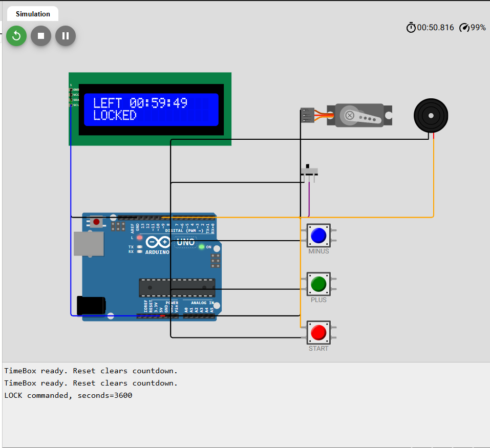
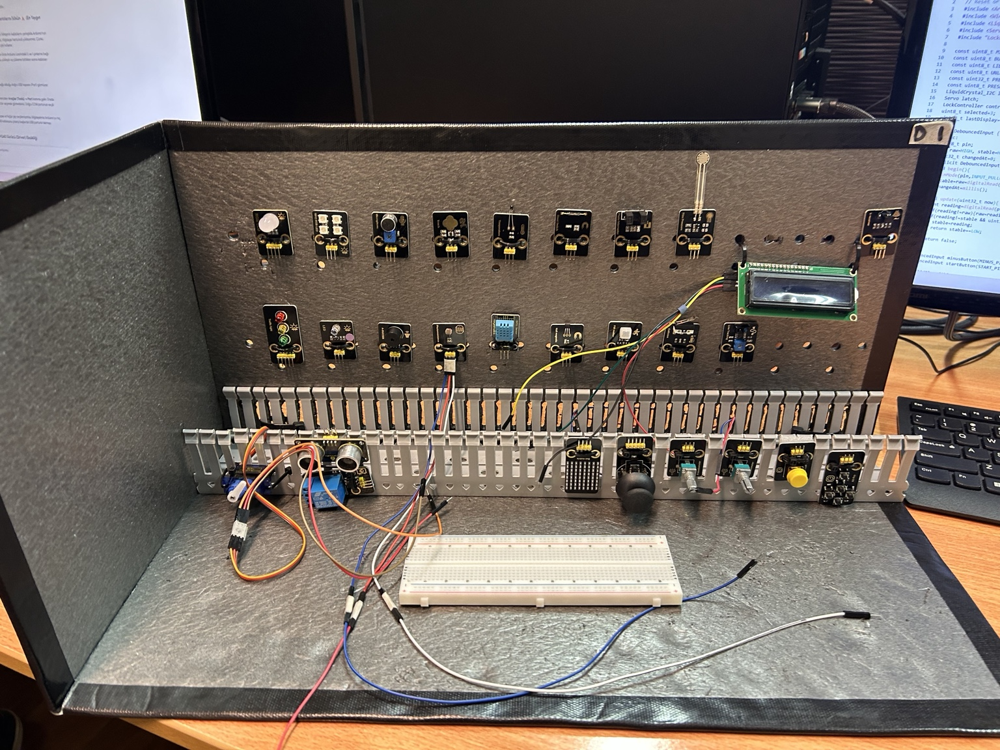
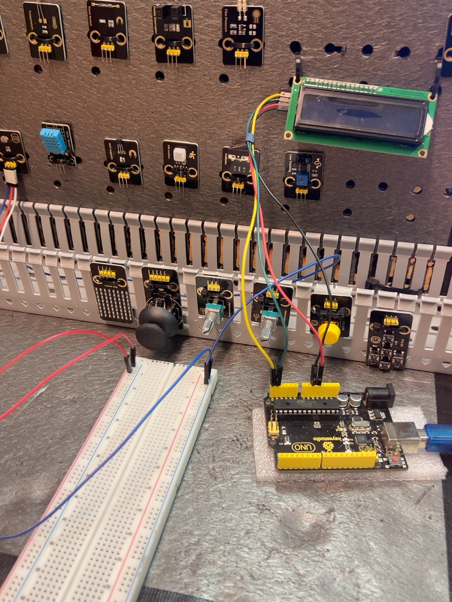
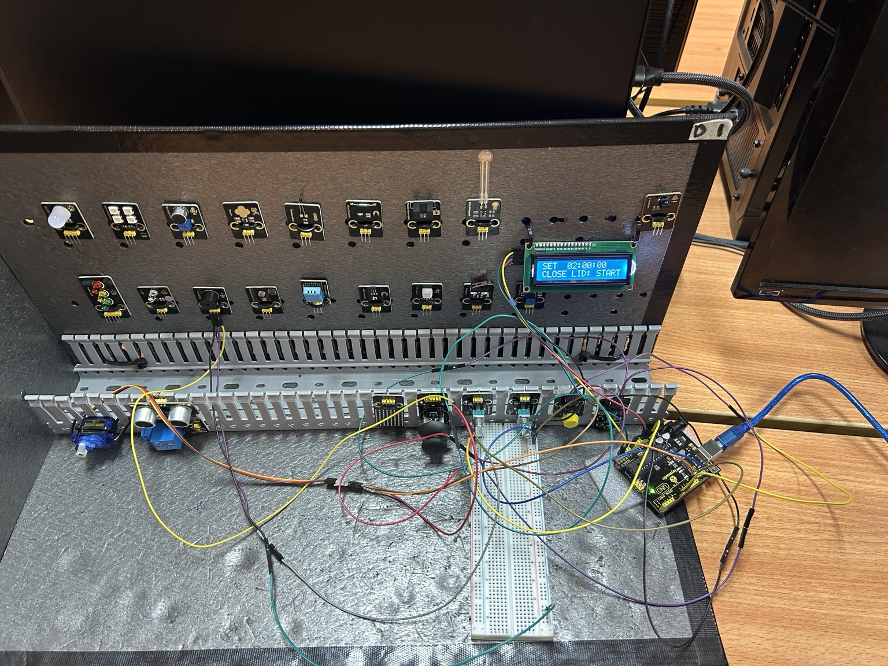

# TimeBox

An Arduino Uno timed lockbox prototype. The user chooses a waiting time, closes the lid by hand, and presses START. A servo receives a lock command. When the countdown ends, the servo receives an unlock command.

**Student:** Sina Gurkan Hosdag · **Group:** 4250Z

**Current stage:** Bench prototype. The screen, keypad, countdown, START button, servo, and buzzer are reported working on the bench prototype. The physical box and latch have not been verified.

## Project files

- [Arduino sketch](firmware/TimeBox_Arduino/TimeBox_Arduino.ino)
- [Project report on GitHub Pages](https://gurkvnw.github.io/timebox/)
- [Development process and build photographs](project/DEVELOPMENT.md)
- [Connections](project/CONNECTIONS.md)
- [Test record](project/TEST_RECORD.csv)
- [Development plan](project/PLAN.md)

## Goal

Build a small system that creates a waiting period before a cigarette box can be opened. This is an educational prototype; no effect on smoking behaviour has been measured.

## Parts

- Arduino Uno compatible board and USB data cable
- 16×2 LCD with an I2C adapter
- Analog keypad module with five small buttons
- Yellow START button module
- Micro servo
- Buzzer module
- Breadboard and jumper wires
- A box and a mechanical latch for the next stage

There is no reed switch, lid sensor, phone application, or wireless connection in this version.

## Upload

1. Download this repository as a ZIP and extract it.
2. Open `firmware/TimeBox_Arduino/TimeBox_Arduino.ino` in Arduino IDE.
3. Install **LiquidCrystal I2C by Frank de Brabander, version 1.1.2**, and **Servo** through Library Manager if they are missing. `Wire` is included with the Uno board package.
4. Select **Arduino Uno** and the USB serial port shown for your board. The port number depends on the computer.
5. Click Verify, then Upload. Wait for **Done uploading**.

The sketch uses only `Wire.h`, `LiquidCrystal_I2C.h`, and `Servo.h`. It does not need `LockController.h`.

## Use

1. Release all buttons during startup.
2. When the LCD shows **Hold key for +**, hold a small keypad button until **Key saved** appears, then release it.
3. At **Hold key for -**, do the same with a different button.
4. Use those two buttons to choose a preset. The default is one hour.
5. For a bench test, press minus three times to select **30 seconds**. Keep the lid open for the first servo test.
6. Press the yellow START button. The LCD shows the remaining time. The selected duration cannot be changed during the countdown.
7. At the end, the LCD shows **TIME IS UP / UNLOCKED** and the sketch commands the servo to return. The buzzer gives an audible signal when the countdown ends.

Available presets: 30 seconds, 15 minutes, 30 minutes, 1 hour, 90 minutes, 2 hours, and 4 hours. Keypad calibration runs again after each restart. Serial Monitor uses 115200 baud; sending `c` starts keypad calibration again when the countdown is not running.

## Connections

| Component signal | Uno pin |
| --- | --- |
| START button S | D4 |
| Analog keypad S | A0 |
| Buzzer S | D8 |
| Servo signal, orange | D9 |
| LCD SDA | A4 |
| LCD SCL | A5 |
| Common ground | GND |

The classroom wiring was changed on the instructor's direction: LCD VCC uses 5V; the shared positive breadboard rail was moved to 3.3V. The student reported connecting the servo red wire to this rail. This describes the reported bench arrangement, rather than a verified voltage requirement for every module. The servo's exact model and current requirements still need to be recorded. See [Connections](project/CONNECTIONS.md).

## How the code works

The sketch first learns the analog values of the released keypad and the two selected buttons. It waits for stable readings to avoid repeated presses caused by button bounce. A new START press records `millis()` and sends a servo position command. The main loop compares elapsed time with the preset without blocking the countdown. At the end, it sends an unlock command and a buzzer signal.

Servo angles are `UNLOCK_ANGLE = 15` and `LOCK_ANGLE = 85`. They are initial bench settings and must be adjusted to the actual latch. The code checks LCD addresses `0x27` and `0x3F`.

## Development process and photographs

### First design in Wokwi

I tested the initial idea in Wokwi with an Uno, LCD, servo, buzzer, and separate adjustment buttons. The screenshot shows an active countdown. A simulated lid input was included at this stage and was later removed from the physical design.

### Early physical assembly

I selected the required modules from the laboratory panel and prepared the breadboard. The panel contains other sensors that are not used by TimeBox.

I collected the GND and supply connections on the breadboard, then connected the LCD and Arduino with help from the instructor. The image below shows an intermediate assembly, before the final circuit was completed.

### Program upload and bench test

I replaced the separate PLUS and MINUS buttons with the analog keypad at A0 and removed the reed switch. I installed the missing LCD library and used a single-file sketch to remove the old LockController.h dependency. After checking the LCD signal connections, the screen displayed the keypad setup prompt. I calibrated two keys and tested a 30-second countdown. The display, buttons, timer, and servo worked. The buzzer has also been confirmed working in the latest bench update.

### Latest physical state

The LCD shows `SET 02:00:00` and `CLOSE LID: START`. This records a selected preset, not a completed two-hour test. The box and mechanical latch still need to be built and tested.

See the [full development process](project/DEVELOPMENT.md) for the build steps and changes from the simulation.

## Known limits

- Reset or power loss clears the countdown and the startup code commands the unlock position. This is not a secure lock.
- Without a lid sensor, the system cannot confirm that the lid is closed.
- The screen reports commanded lock states; it cannot measure the actual latch position.
- A completed box, latch strength, loaded servo movement, and long-duration runs have not been tested.
- The repository sketch is the saved version that was supplied for the bench test. Later local edits, such as a longer beep, have not been confirmed or included.

## References

- [Arduino Uno](https://docs.arduino.cc/hardware/uno-rev3/)
- [Upload a sketch](https://support.arduino.cc/hc/en-us/articles/4733418441116-Upload-a-sketch-in-Arduino-IDE)
- [LiquidCrystal I2C](https://docs.arduino.cc/libraries/liquidcrystal-i2c/)
- [GitHub Pages publishing source](https://docs.github.com/en/pages/getting-started-with-github-pages/configuring-a-publishing-source-for-your-github-pages-site)
