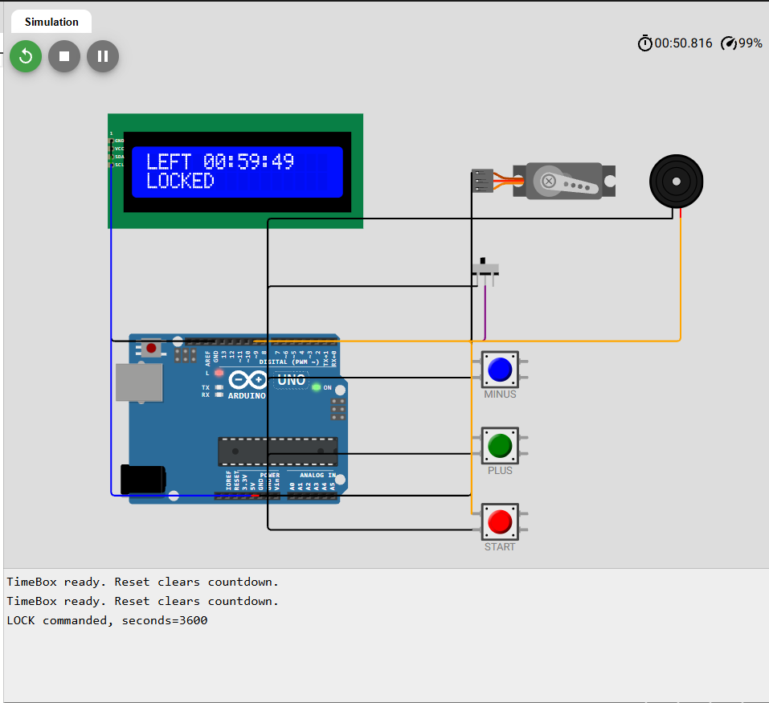
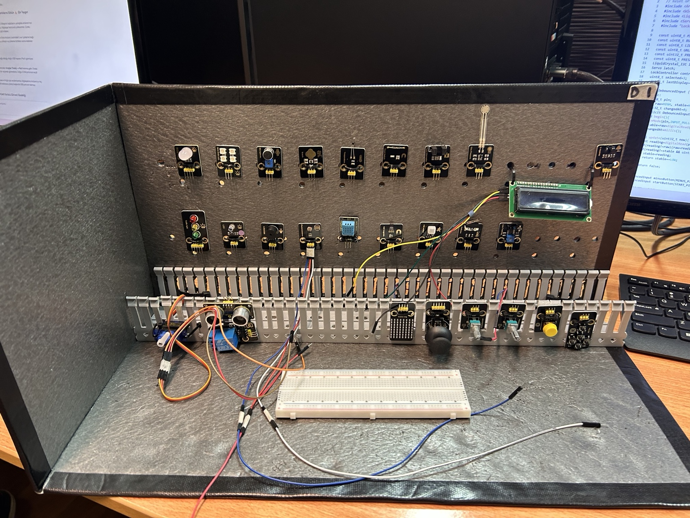
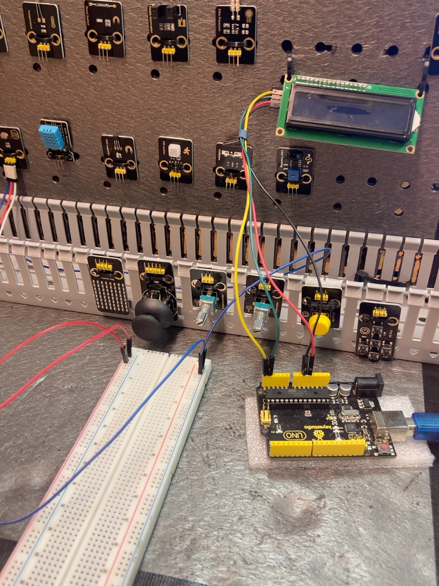
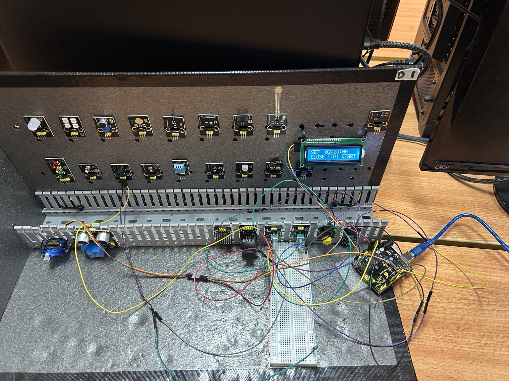

# Development process

**Project:** TimeBox · **Student:** Sina Gurkan Hosdag · **Group:** 4250Z

This record follows the order of the project work, from the first simulation to the latest physical bench assembly. The photographs show stages of the build; they are not electrical wiring diagrams.

## 1. Define the idea

I chose to build a timed cigarette box. The user selects a waiting time and presses START. A servo receives a lock command, and the LCD shows the remaining time. When the countdown ends, the servo returns to its unlock position. I kept the first version independent of a phone application.

## 2. Simulate the first circuit in Wokwi

I started with an Arduino Uno simulation, an I2C LCD, a servo, a buzzer, and separate PLUS, MINUS, and START buttons. The first design also included a switch input to represent the lid being closed.

The screenshot shows an active countdown with `LEFT 00:59:49` and `LOCKED` on the LCD. The serial output records a lock command for 3,600 seconds. This is evidence of the original simulation, rather than the final physical wiring.

## 3. Select components in the laboratory

I used the laboratory training panel and a separate breadboard. I identified the LCD, micro servo, buzzer, yellow START button, and small analog keypad. The panel also contains many other sensors and modules; these are not all part of TimeBox.

## 4. Prepare the breadboard connections

I used the breadboard rails to collect the ground and power connections. For the button, keypad, and buzzer modules, I followed the G, V, and S labels: G is ground, V is supply, and S is the signal connection. I first prepared these connections with the Arduino signal ends left loose so the assembly could be checked before power was applied.

During the physical build, the laboratory assistant advised that the reed switch was not needed. I removed it. The physical system therefore relies on the user closing the lid before pressing START; it cannot detect the lid position.

## 5. Connect the Arduino and LCD

With help from the instructor, I connected the LCD and prepared the other module connections. The signal mapping for the completed bench design is:

| Signal | Uno pin |
| --- | --- |
| Yellow START button | D4 |
| Analog keypad | A0 |
| Buzzer | D8 |
| Servo | D9 |
| LCD SDA / SCL | A4 / A5 |

This is an intermediate photograph, not a reference for the completed pin mapping. The final power arrangement was adjusted on the instructor's direction: the display uses 5V and the shared module rail was connected to 3.3V. The exact servo model and its supply requirements still need to be documented; see [Connections](CONNECTIONS.md).

## 6. Adapt and upload the program

The original simulation used two separate adjustment buttons and a lid input. I changed the physical version to read the analog keypad through A0 and removed the lid check. The final sketch keeps the countdown logic in one Arduino file and uses Wire, LiquidCrystal_I2C, and Servo.

In Arduino IDE, I selected Arduino Uno and its USB port. The first compile attempt could not find LiquidCrystal_I2C, so I installed the LCD library. A later attempt could not find LockController.h from the old project. The single-file sketch removed that dependency. After uploading the updated sketch, Arduino IDE showed “Done uploading”. This upload result was recorded during the bench session; a successful-upload IDE screenshot has not yet been supplied for this report.

At first, the physical LCD showed only lines. After checking and reconnecting the display signal connections, it showed “Hold key for +”. I then taught the program which keypad buttons to use for plus and minus.

## 7. Test the physical prototype

I selected the 30-second preset and used the yellow START button. In the bench test, the display, keypad, countdown, START button, and servo worked. The buzzer did not make a sound, so this part remains unfinished. I have not recorded a successful buzzer retest.

## 8. Latest physical state

The photograph below is the latest bench assembly. It shows the Uno connected by USB, the breadboard wiring, and the LCD displaying `SET 02:00:00` and `CLOSE LID: START`. The selected two-hour value demonstrates a displayed setting; this photo does not prove that a two-hour countdown was completed.

The physical work currently ends at this bench prototype. A separate box, servo-operated latch, tests under mechanical load, and a working buzzer are the next tasks. The current program also clears the countdown after reset or power loss.

## Changes from the simulation

| First Wokwi version | Physical bench version |
| --- | --- |
| Separate PLUS and MINUS buttons | Two learned buttons on an analog keypad at A0 |
| Lid switch input | Removed following laboratory advice |
| Simulation output | Real LCD, wiring, and servo movement |
| Old LockController.h dependency | One Arduino sketch without that extra file |
| Planned sound alert | Buzzer remains an open hardware test |

